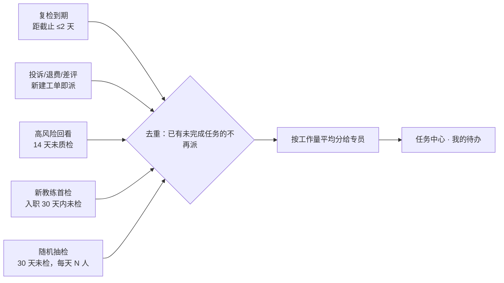
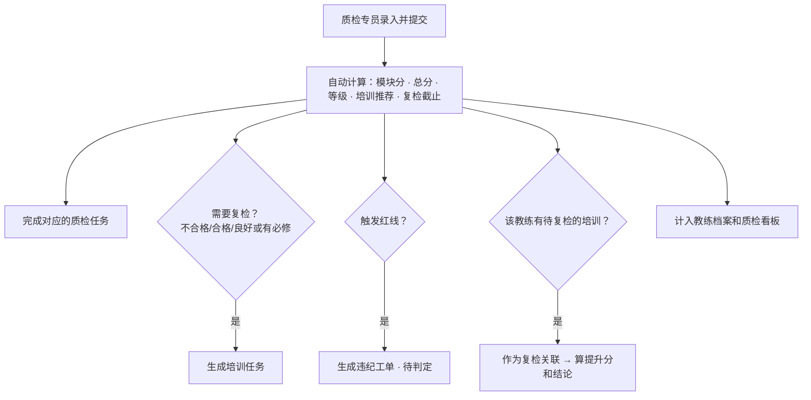
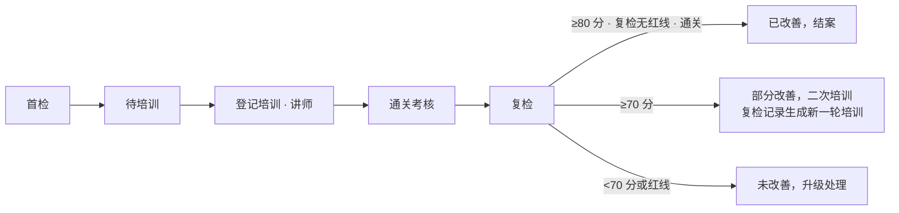
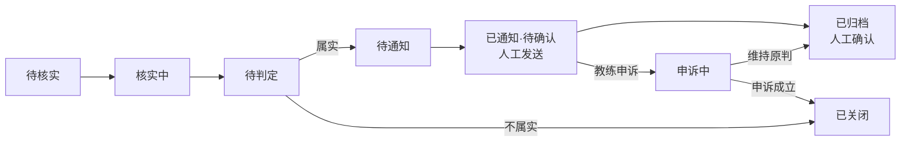
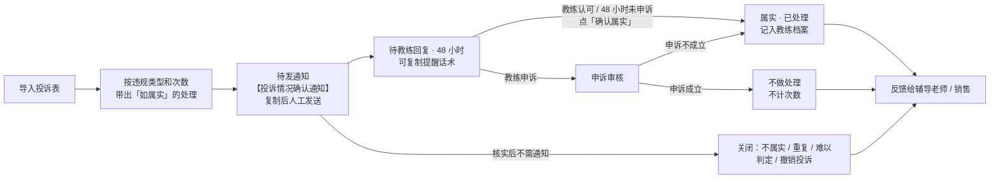

# 师资运营工作台（51Talk）

单词 2.2 课程质检的团队工作台。质检专员按标准在线打分，系统自动算分、推荐培训、安排复检、生成违纪工单，并每天按规则把质检任务派给专员。所有进度在一个任务中心里跟踪，不再导表。

- 部署方式：GitHub Pages（网页）+ Supabase（数据库与登录）
- 部署步骤见 [DEPLOY.md](DEPLOY.md)

---

## 一、功能模块

左侧菜单分四组：

| 分组 | 菜单 | 做什么 |
|---|---|---|
| 工作空间 | 总览 | 经营指标（本周 vs 上周，接入前显示「待接入」）+ 质检指标（今日任务、待复检、处理中工单、近 7 天均分），下方为可扩展的模块卡片 |
| | 任务中心 | 质检任务、复检、培训跟进、工单统一成进度工单；我的待办；自动派发设置 |
| 经营 · 转化（规划中） | 经营盘 / 转化分析 / 订单与退费 | 经营数据接入后开放，目前显示为灰色 |
| 质检 · 流程 | 课堂质检 | 录入（体验课 95 项 / 正课 76 项）、记录、看板、标准库 |
| | 投诉管理 | 导入家长 / 辅导老师 / 销售的投诉，自动生成【投诉情况确认通知】，48 小时后确认属实，并生成给辅导老师 / 销售的处理反馈 |
| | 培训跟踪 | 待培训 / 待复检 / 超期 / 结案；登记培训与通关考核 |
| | 工单台 | 违纪工单和外部反馈工单，按「核实 → 判定 → 通知 → 闭环」处理 |
| | 通知中心 | 自动生成【质检违纪通知】话术，人工发送后标记，录入教练确认或申诉 |
| 数据 | 教练档案 | 名单、组织信息、画像标签、退费、质检与工单历史、风险等级 |
| | 导入 | 教练信息、退费明细、手动新建工单、成员权限 |
| | 设置 | 质检标准库、自动派发、画像标签、高退费判定、成员权限、架构蓝图、日夜主题的入口 |

**顶栏全局筛选**：周次（周一到周日）、教练类型（全职 / 专职 / 兼职 / 跨带）、团队。作用于任务中心、课堂质检记录、培训跟踪、工单台、教练档案；选择会记在本机浏览器里。

**右栏**：时钟、我的待办、复检提醒、工单预警、账号。总览和任务中心默认展开，其他页面默认收起成一条细栏；每个页面记住自己的展开状态。点右上角头像可展开右栏退出登录。

---|---|---|
| 01 | 总览 | 今日任务完成度、近 7 天质检量与均分、等级分布、工单进度 |
| 02 | 任务中心 | 质检任务、复检、培训跟进、工单统一成进度工单；我的待办；自动派发设置 |
| 03 | 课堂质检 | 录入（体验课 95 项 / 正课 76 项）、记录、看板、标准库 |
| 04 | 培训跟踪 | 待培训 / 待复检 / 超期 / 结案；登记培训与通关考核 |
| 05 | 工单台 | 违纪工单和外部反馈工单，按「核实 → 判定 → 通知 → 闭环」处理 |
| 06 | 通知中心 | 自动生成【质检违纪通知】话术，人工发送后标记，录入教练确认或申诉 |
| 07 | 教练档案 | 名单、组织信息、画像标签、退费、质检与工单历史、风险等级 |
| 08 | 导入 | 教练信息、退费明细、手动新建工单、成员权限 |

---

## 二、核心流程

### 1. 质检任务从哪里来（自动派发）

每天第一位有编辑权限的同事打开工作台时，系统按以下优先级抽取教练，平均派给质检专员（每人有每日上限），一天只派一次。



- 复检到期、投诉触发为必派，不受每日上限限制。
- 体验 / 正课 / 跨带教练按「教练标签」自动选用对应标准。
- 所有天数、人数在「任务中心 → 派发设置」里由管理员调整。

### 2. 一次质检提交后自动发生什么



### 3. 培训闭环



复检期限：不合格（含红线）7 天 · 合格 14 天 · 良好或有必修 30 天。

### 4. 工单处理



课堂质检红线课已有质检证据，直接进入「待判定」。

### 5. 投诉处理



- 通知语气：先说明收到的反馈、请教练补充说明，再写「如经核实情况属实」的处理方式，不预先定性。发给教练的情况描述可以在发送前改得更客观、委婉。
- 48 小时：发送后显示倒计时；到期后在投诉列表「48 小时已到」、任务中心、右栏预警里提醒，打开工作台时也会弹出提示，点「确认属实」即可。
- 反馈提交人：发送通知后生成受理反馈；出结论（属实 / 申诉成立 / 关闭）后生成处理结果反馈，复制给辅导老师或销售，点「我已反馈」完成闭环。
- 导入：可直接用「LE/LC 投诉渠道」原表。投诉来源自动识别为家长 / 辅导老师 / 销售；表里有「是否属实」的行作为历史记录导入，属实的计入违规次数。学生姓名、截图不导入。
- 处罚规则：在「投诉管理 → 处罚规则」维护「违规类型 → 首次 / 第 2 次 / 第 3 次处罚」和匹配关键词。次数按同一教练、同一违规类型此前属实的投诉计算。
- 同一教练有多条待发通知时，可在「按教练合并通知」里合并成一条发送。
- 联动：导入时给被投诉教练派一节质检；属实后如果之后还没质检过，再派一次；近 90 天属实投诉 ≥ 2 条标为高风险（天数、条数可调）。

### 6. 高退费判定

退费明细里每笔退费可以同时有**体验课教练**和**正课教练**，导入时分别对应「体验课教练ID / 姓名」和「正课教练ID / 姓名」两组列：

- 两位教练各记一条退费，并标明角色（体验课 / 正课）；两列是同一人时只记一条（体验+正课）。
- 只有一类教练 ID 的退费单也会导入；两类 ID 都没有的行跳过。
- 有订单号时按「订单号 + 角色」去重，重复导入不会重复计数。

每笔退费按「退费前第几次课」分类：

| 分类 | 节次 |
|---|---|
| 前 3 节退费 | 第 0–3 节（第 0 节＝还没上正课就退费） |
| 前 6 节退费 | 第 4–6 节 |
| 其他退费 | 第 7 节及以后；节次为空时，「是否前三节课内退费」为「是」的归入前 3 节，其余归入其他 |

近 90 天退费 ≥ 3 单为高退费，按教练最多的一类归类。天数、单数，以及**计入哪类教练**（体验课和正课都算 / 只算体验课 / 只算正课）都在「导入 → 退费明细 → 高退费判定」里调整。高退费教练自动标为高风险并进入每日质检派发；个别教练可在档案里手动标记或取消。

---|---|
| 前 3 节退费 | 第 1–3 节 |
| 前 6 节退费 | 第 4–6 节 |
| 其他退费 | 第 7 节及以后、未填节次 |

近 90 天退费 ≥ 3 单为高退费（天数和单数可调），按教练最多的一类归类。高退费教练自动标为高风险并进入每日质检派发；个别教练可在档案里手动标记或取消。

---

## 三、评分规则（来自标准表）

| | 体验课 | 正课 |
|---|---|---|
| 检查点 | 95 项，7 个模块，满分 100 | 76 项，6 个维度 19 个指标，满分 100 |
| 等级 | 优秀 ≥90 · 良好 80–89 · 合格 70–79 · 不合格 <70 | 标杆级 ≥99 · 优秀 90–98 · 良好 76–89 · 合格 70–75 · 不合格 <70 |
| 红线 | R1–R7 任一触发即不合格 | R1–R5 触发即不合格；R6 不予评分、退回重检 |
| 附加项 | 课后服务 & 抗遗忘 S1–S22（达标制） | 复习课单元环节 RV1–RV6（达标制） |
| 培训推荐 | 课程关联检查点失分率 <20% 选修 · 20–50% 必修 · ≥50% 必修+磨课 | 同左 |

标准由管理员在「课堂质检 → 标准库」维护：可在线编辑，也可上传新版 Excel。每次保存为新版本，已提交的记录保留当时的分数和等级。

---

## 四、角色与权限

| 能做的事 | 管理员 | 质检专员 | 只读 |
|---|:-:|:-:|:-:|
| 查看所有数据 | ✓ | ✓ | ✓ |
| 录入质检、处理任务 / 工单 / 培训、打画像标签 | ✓ | ✓ | |
| 修改质检标准、标签选项 | ✓ | | |
| 导入教练信息、退费明细 | ✓ | | |
| 派发设置、成员权限 | ✓ | | |

- 第一个注册的账号自动成为管理员。
- 其他同事用工作邮箱注册后为「待审核」，看不到任何数据，管理员在「导入 → 成员权限」分配角色后才能使用。
- 权限由数据库的行级规则强制执行，不依赖页面。

---

## 五、日常操作清单

**管理员**
- 每月或名单变动时：导入 → 教练信息，上传最新教练表（按业务系统编号合并更新）
- 每周：导入 → 退费明细，上传最新退费数据
- 新同事入职：导入 → 成员权限，分配角色；任务中心 → 派发设置，加入质检专员
- 标准更新时：课堂质检 → 标准库 → 上传新版 Excel 或在线编辑

**质检专员**
- 打开工作台 → 右侧「我的待办」或任务中心 → 点任务「开始质检」
- 逐项点选未达成的检查点 → 处理右侧数据校验提示 → 提交
- 处理分派给自己的工单：核实 → 判定 → 复制通知话术人工发送 → 标记已通知 → 录入确认或申诉
- 登记培训日期、讲师、通关考核；到复检日录入复检质检

**主管（只读）**
- 总览看今日任务完成度和质检趋势；看板看高频问题；教练档案看高风险和高退费名单

---

## 六、数据与隐私

- 所有业务数据（教练名单、质检记录、任务、工单、退费、标准）存放在 Supabase 数据库，需要登录且被授权才能读取。
- GitHub 仓库里只有网页代码，没有任何业务数据，也不包含质检标准内容（标准在部署后由管理员上传进数据库）。
- 导入时手机号、身份证、金额等列默认不导入。
- `config.js` 里的 anon key 是设计上允许公开的密钥；切勿把 service_role key 放进仓库。

---

## 七、文件说明

```
index.html            工作台网页（全部功能）
config.js             数据库连接配置（部署时填写）
supabase/setup.sql    数据库初始化脚本（建表 + 权限 + 实时同步）
vendor/               数据库组件和表格组件（部署时放入，见 DEPLOY.md 第 5+ 步）
README.md             本说明
DEPLOY.md             部署步骤
```
